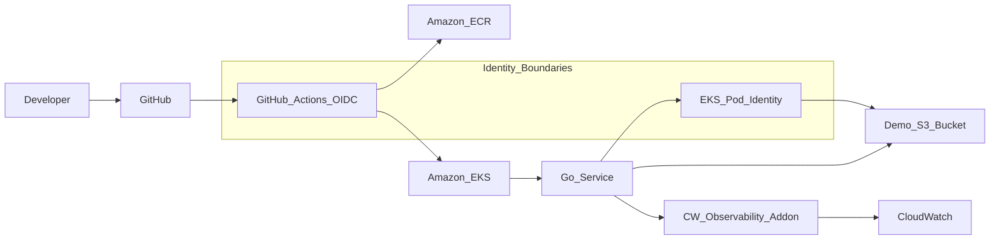

# Secure, Observable Go Microservice Golden Path on Amazon EKS

Reference implementation for **Building a Secure, Observable Golden Path for Go Microservices on Amazon EKS**.

A successful Kubernetes deploy is not, by itself, a production-ready platform. This repository makes secure deployment, workload identity, network boundaries, repeatable delivery, and operational visibility part of the default path for a small Go service.

> **Safety:** Automated work in this repo does **not** run `terraform apply` or destroy AWS resources. Live deployment requires your explicit approval and credentials.

## Architecture

Publication diagram (AWS Architecture Icons + brand icons): import [`docs/architecture.drawio.xml`](docs/architecture.drawio.xml) into [diagrams.net](https://app.diagrams.net/) → **File → Open from → Device**, then export PNG/SVG.



**Layers**

1. **Infrastructure** — Terraform VPC (private nodes, NAT egress), EKS, add-ons  
2. **Delivery** — GitHub Actions CI + OIDC deploy to ECR/Helm  
3. **Runtime security** — Pod Identity, NetworkPolicies, restricted PSS  
4. **Operations** — probes, metrics, CloudWatch Observability, failure experiments  

## Repository structure

```text
app/                  Go HTTP service + tests
Dockerfile            Multi-stage non-root image
terraform/            VPC, EKS, IAM/OIDC, Pod Identity, ECR, S3
helm/platform-demo/   Hardened Helm chart
.github/workflows/    ci.yml, deploy.yml (SHA-pinned actions)
scripts/validate.sh   Local quality gates
experiments/          Live-cluster behavioural tests
docs/                 Deep-dive + evidence template
```

## Prerequisites

| Tool | Purpose |
| ---- | ------- |
| Go 1.23+ | Build/test the service |
| Docker | Image builds |
| Terraform >= 1.5 | Infrastructure |
| AWS CLI v2 | Deploy / experiments |
| kubectl, Helm 3 | Cluster deploy |
| Optional: tflint, shellcheck | Extra local gates |

## Quick start (local validation only)

```bash
./scripts/validate.sh
```

This runs Go fmt/vet/test/build, Docker build (if available), Helm lint/template (if available), and Terraform fmt/init/validate (if available). It never calls AWS APIs that mutate resources.

## Configuration variables

See [`terraform/terraform.tfvars.example`](terraform/terraform.tfvars.example).

Critical variables:

- `aws_region`, `kubernetes_version` — verify with `aws eks describe-cluster-versions`
- `github_org`, `github_repo`, `github_deploy_branch`
- `github_oidc_use_immutable_subjects` + owner/repo IDs when required
- `network_policy_enforcing_mode` (`standard` \| `strict`)

## Identify a supported EKS version

```bash
aws eks describe-cluster-versions --region us-east-1 \
  --query 'clusterVersions[?status==`STANDARD_SUPPORT`].clusterVersion'
```

Default in this repo: `1.35` (override after checking your region).

## Configure AWS credentials locally

```bash
aws configure   # or SSO: aws sso login --profile your-profile
export AWS_PROFILE=your-profile
aws sts get-caller-identity
```

Use an IAM principal with permission to create networking, EKS, IAM, ECR, and S3. **Do not use the AWS account root user.**

## Terraform init / validate / apply

```bash
cd terraform
cp terraform.tfvars.example terraform.tfvars   # edit values
terraform init
terraform validate
terraform plan -out=tfplan
# Explicit approval required:
terraform apply tfplan
```

Full steps: [docs/deployment.md](docs/deployment.md).

## EKS access

- Cluster creator receives admin via `enable_cluster_creator_admin_permissions`
- GitHub deploy role receives **namespace-scoped** `AmazonEKSAdminPolicy` for `platform-demo`
- Application namespace (with PSS labels) is created by Terraform

```bash
aws eks update-kubeconfig --region "$AWS_REGION" --name "$(terraform -chdir=terraform output -raw cluster_name)"
```

## Helm deployment

```bash
helm upgrade --install platform-demo ./helm/platform-demo \
  --namespace platform-demo \
  --set image.repository="$ECR_URL" \
  --set image.tag="sha-$(git rev-parse HEAD)" \
  --set env.DEMO_BUCKET="$BUCKET" \
  --set env.AWS_REGION="$AWS_REGION" \
  --wait
```

Chart includes Deployment, ServiceAccount, ClusterIP Service, probes, resources, securityContext, PDB, HPA, NetworkPolicy.

## GitHub setup and OIDC

1. Push this repository to GitHub  
2. Fill Terraform GitHub variables and apply  
3. Set Actions **variables** listed in [docs/deployment.md](docs/deployment.md)  
4. Read [docs/oidc-github.md](docs/oidc-github.md) for immutable subject claims  

CI runs on PRs/pushes. Deploy runs on `main` via OIDC (no AWS keys in secrets).

## Validation experiments

| Script | Purpose |
| ------ | ------- |
| `experiments/01-pod-recovery.sh` | Pod delete → replacement |
| `experiments/02-rollout.sh` | Rollout status / rollback notes |
| `experiments/03-workload-identity.sh` | Pod Identity allow + deny |
| `experiments/04-network-isolation.sh` | NetworkPolicy allow/deny + DNS |
| `experiments/05-autoscaling.sh` | HPA under bounded `/work` load |
| `experiments/06-observability.sh` | CloudWatch verification guide |

Details: [docs/network-policy.md](docs/network-policy.md), [docs/observability.md](docs/observability.md).

## Cost and teardown

See [docs/cost-and-teardown.md](docs/cost-and-teardown.md). Tear down demo environments promptly (NAT + EKS + nodes dominate cost).

## Evidence and article alignment

- Fill [docs/evidence-template.md](docs/evidence-template.md) with **real** outputs only  
- Claim status: [docs/article-alignment.md](docs/article-alignment.md)  
- Initial empty-repo audit: [docs/audit.md](docs/audit.md)  

## Known limitations

- NetworkPolicy HTTPS egress to AWS is port-based (443), not destination-scoped to specific AWS prefixes  
- HPA and CloudWatch claims require live observation — manifests alone are insufficient  
- Distributed tracing is implemented in-process but must not be claimed until traces appear in CloudWatch/X-Ray  
- Not a full production platform (secrets lifecycle, admission policy, DR, multi-env promotion are out of scope)  
- `strict` network policy mode needs extra system-pod policies before use  

## Local commands

```bash
make validate   # full local gates including container smoke test
make test
make smoke      # docker run + curl health/metrics/work
make help
```

## License

MIT — see [LICENSE](LICENSE). Adapt IAM, networking, and retention to your organisation’s standards before production use.
